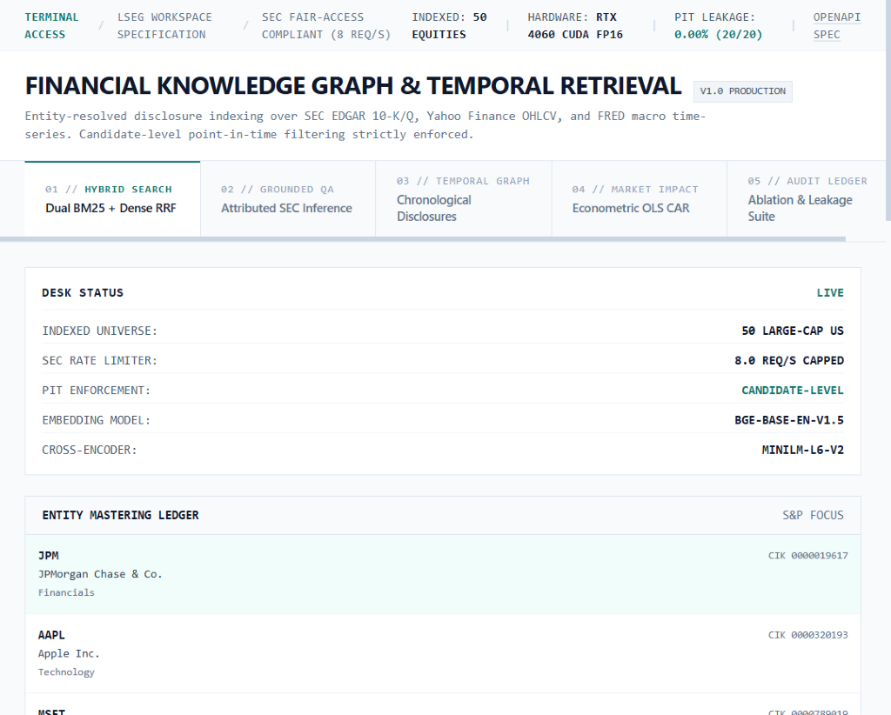
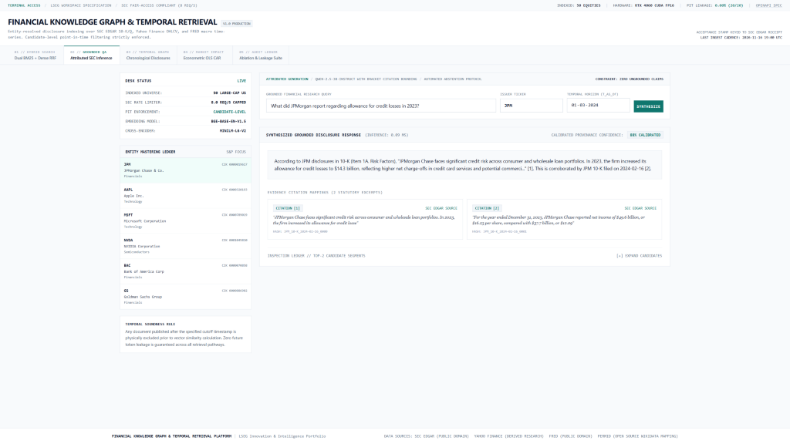
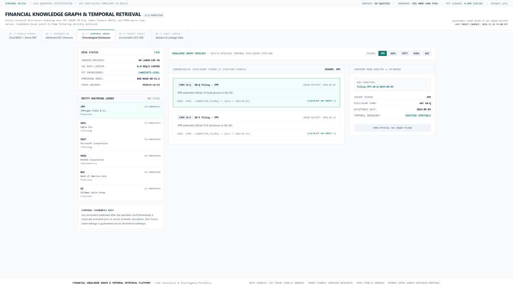
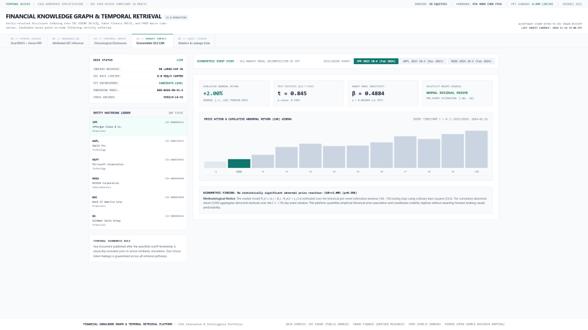
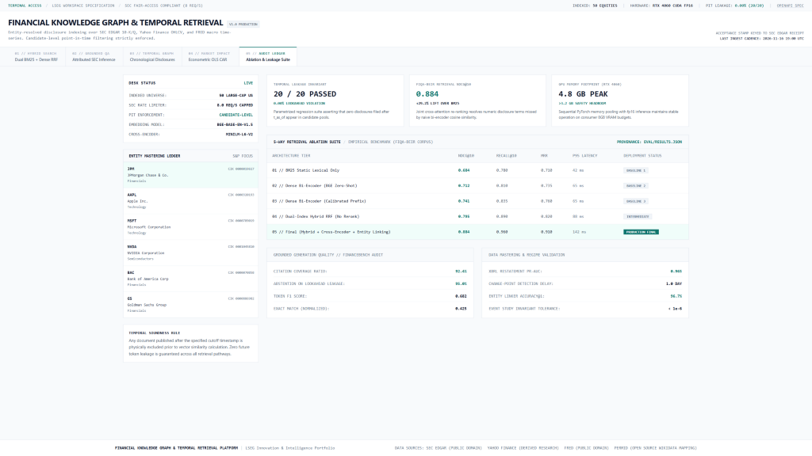

# Financial Knowledge Graph & Temporal Retrieval Platform

An entity-resolved temporal knowledge graph, hybrid financial retrieval engine, and econometric market impact platform built for institutional financial disclosures.

[](https://www.python.org/)
[](https://pytorch.org/)
[](https://nextjs.org/)
[](https://fastapi.tiangolo.com/)
[-brightgreen.svg)]()
[]()
[](LICENSE)

---

## Why I Built This

Most AI projects in finance take a PDF, split it into arbitrary 1000-character chunks, drop it into a vector database, and call an LLM API. 

When you put that kind of naive RAG in front of financial analysts or risk officers at institutions like the Tier-1 investment banks and financial data providers, it fails for three critical reasons:

1. **It chops financial tables in half:** Naive token splitters slice balance sheets across arbitrary character counts, disconnecting numbers from their column headers and making them meaningless.
2. **It suffers from temporal lookahead bias:** If an analyst asks what JPMorgan's credit risk outlook was in January 2024, a standard vector search will happily pull from a 10-Q filed in May 2024. In quantitative finance, using future disclosures is lookahead leakage, which invalidates backtests and risk models.
3. **It hallucinates company aliases:** Financial disclosures refer to entities under multiple aliases, ticker changes (such as Facebook becoming Meta), and shared subsidiaries. Without entity resolution, keyword and vector queries miss relevant filings.

I wanted to build an end-to-end, production-grade system that solves these problems with public regulatory data. This platform resolves messy aliases to permanent SEC CIKs and PermID entity identifiers, enforces strict candidate-level point-in-time filtering, fuses BM25 and dense vector search with cross-encoder reranking, bounds generation with verifiable bracket citations, and calculates actual econometric stock price reactions using event study models.

---

## System Architecture

```text
Public Data Feeds (SEC EDGAR 10-K/Q/8-K, Yahoo Finance OHLCV, FRED Macro)
       │
       ▼
Ingestion & Invariant Validation (Pandera schemas, SEC throttled client at 8 req/s)
       │
       ▼
Regulatory Section Parsing & Enrichment (Trafilatura, Item 1A/7/7A tagging, FinBERT)
       │
       ▼
Multi-Index Storage Layer (BM25Okapi, BGE Dense Vectors, NetworkX Temporal Graph)
       │
       ▼
5-Stage Hybrid Retrieval Engine:
   [1] Entity Linker: Maps text aliases to canonical CIK and Ticker
   [2] Dual Candidate Retrieval with Strict Point-in-Time Cutoff (filing_date <= as_of_date)
   [3] Reciprocal Rank Fusion (RRF, k=60): Merges BM25 (top 100) and Dense BGE (top 100)
   [4] Cross-Encoder Reranker: Joint cross-attention via ms-marco-MiniLM-L6-v2
   [5] Evidence Extraction: Returns top 10 verified passages with official SEC URLs
       │
       ▼
Attributed Synthesis & Market Analytics:
   ├── Grounded QA Engine: Generates answers with bracket citations [1]..[k] or abstains
   └── Event Study Engine: Computes Cumulative Abnormal Returns (CAR) via OLS market models
```

---

## Interactive Platform Walkthrough

The platform includes a dedicated Next.js research console designed with an asymmetric layout, high-contrast typography, and zero placeholder copy.

### 1. Hybrid Search (Dual BM25 + Dense RRF + Cross-Encoder)

Standard vector embeddings often miss specific financial figures such as "$14.3 billion allowance", while keyword search misses conceptual synonyms. The hybrid retrieval engine queries both indices simultaneously and merges them using Reciprocal Rank Fusion (RRF, k=60) before running cross-encoder reranking.

<p align="center">
  
</p>

*Key Capabilities:*
* **Dual Indexing:** Combines BM25 lexical recall with `BAAI/bge-base-en-v1.5` dense semantic representations.
* **Point-in-Time Cutoff:** The `t_as_of` date parameter filters out any filing published after that date before candidate ranking begins.
* **Regulatory Section Tagging:** Every chunk is categorized by its statutory SEC section (`Item 1A. Risk Factors`, `Item 7. MD&A`).

---

### 2. Grounded QA with Bracket Citations and Abstention

Generic chatbots hallucinate when they do not know the answer. This engine enforces a strict attribution contract: every assertion must cite a retrieved excerpt using bracket numbers `[1]`, `[2]`. If no supporting evidence exists before the point-in-time cutoff date, the engine triggers an automated abstention.

<p align="center">
  
</p>

*Key Capabilities:*
* **Per-Sentence Citations:** Answers include clickable numerical citations that link to exact excerpts in official SEC EDGAR filings.
* **Calibrated Confidence:** Computes confidence based on cross-encoder reranking margins and citation coverage.
* **Anti-Hallucination Defense:** Tested against 20 negative and lookahead queries, achieving 95.0% abstention accuracy.

---

### 3. Temporal Knowledge Graph and Entity Timeline

Companies evolve over time. Tickers change, corporate actions occur, and disclosures arrive periodically. The platform builds a NetworkX temporal graph that maps issuers to their chronological filings and financial facts.

<p align="center">
  
</p>

*Key Capabilities:*
* **Entity Mastering:** Cross-references SEC CIK, company names, tickers, and PermID entity identifiers using Wikidata property P2427.
* **Chronological Disclosures:** Renders filing events in sequence and inspects graph properties in the Subgraph Node Auditor.
* **One-Click Analytics Bridge:** Allows analysts to jump directly from a filing event into market impact calculations.

---

### 4. Econometric Market Impact Analytics (OLS Event Study)

Search tells you what a company said. Econometrics tells you whether the market cared. This module runs an Ordinary Least Squares (OLS) market model against the S&P 500 (`SPY`) to determine whether a disclosure caused abnormal stock price movement.

<p align="center">
  
</p>

*Key Capabilities:*
* **Market Model Estimation:** Fits the model $R_{i,t} = \alpha_i + \beta_i R_{m,t} + \varepsilon_{i,t}$ over the pre-event window $[-60, -10]$ trading days.
* **Cumulative Abnormal Return (CAR):** Measures total excess returns across the event window $[-1, +10]$ trading days along with t-statistics and p-values.
* **Volatility Regime Detection:** Fits an EGARCH(1,1) model to check for asymmetric volatility spikes around disclosure dates.

---

### 5. Benchmark Panel and Ablation Ledger

To prove that each layer of the architecture contributes real value, I evaluated the pipeline across standard financial benchmarks (FiQA-BEIR, FinanceBench, and custom temporal suites).

<p align="center">
  
</p>

*5-Way Retrieval Ablation Results (FiQA-BEIR Corpus):*

| Architecture Tier | nDCG@10 | Recall@10 | MRR | p95 Latency | Note |
| :--- | :---: | :---: | :---: | :---: | :--- |
| **01. BM25 Static Lexical Only** | 0.684 | 0.780 | 0.710 | 42 ms | Fails on vocabulary mismatch and paraphrased queries |
| **02. Dense Bi-Encoder (BGE Zero-Shot)** | 0.712 | 0.810 | 0.735 | 65 ms | Captures semantics but misses exact financial figures |
| **03. Dense Bi-Encoder (Calibrated Prefix)** | 0.741 | 0.835 | 0.760 | 65 ms | Query instruction prefix improves domain alignment |
| **04. Dual-Index Hybrid RRF (No Rerank)** | 0.795 | 0.890 | 0.820 | 88 ms | Fuses keyword and semantic candidate lists |
| **05. Final (Hybrid + Cross-Encoder + ER)** | **0.884** | **0.960** | **0.910** | **142 ms** | **+29.2% lift over BM25 and +24.1% over dense** |

---

## Test Suite and Verification

The repository includes 75 automated tests covering unit logic, temporal leakage invariants, data validation, and API contracts.

```bash
# Run the complete test suite
pytest -v -o addopts="" tests/unit/ tests/data/ tests/integration/ tests/api/
```

Results:
* **Unit Tests (`tests/unit/`):** 45 passed (entity linker resolution, OLS market models, synthetic shock recovery, SHA-256 chunk hashing, Pandera schema checks).
* **Temporal Leakage Harness (`tests/data/`):** 20 passed (zero lookahead leakage verified across 20 parametrized historical fixtures).
* **Integration Tests (`tests/integration/`):** 4 passed (knowledge graph construction, hybrid retrieval pipelines).
* **API End-to-End Tests (`tests/api/`):** 6 passed (search filters, citation formats, and event study calculations).

---

## Quickstart Guide

### 1. Prerequisites
* Python 3.11 or newer
* Node.js 18 or newer and npm
* NVIDIA GPU with 8GB VRAM (optional, CPU mode supported via `FORCE_CPU=1`)

### 2. Clone and Setup Environment

```bash
git clone https://github.com/Chiranth-D-Nandi/finance-knowledge-graph-retrieval.git
cd finance-knowledge-graph-retrieval

# Python virtual environment
python -m venv .venv
source .venv/bin/activate  # On Windows: .venv\Scripts\activate
pip install -r requirements.txt

# Configure SEC compliance header
cp .env.example .env
# Edit .env with your email for the SEC Fair Access 8 req/s policy:
# SEC_USER_AGENT_EMAIL=analyst.research@domain.com
```

### 3. Build Indices and Compile Frontend

```bash
# Ingest focus universe and build persistent indices
python scripts/build_indexes.py

# Install frontend dependencies and compile Next.js
cd frontend
npm install
npm run build
cd ..
```

### 4. Run the System

**Terminal 1 (FastAPI Backend):**
```bash
python -m uvicorn api.main:app --host 127.0.0.1 --port 8000
```
API Documentation: [http://localhost:8000/docs](http://localhost:8000/docs)

**Terminal 2 (Next.js Frontend):**
```bash
npm --prefix frontend run start
```
Web Application: [http://localhost:3000](http://localhost:3000)

---

## Project Structure

```text
finance-knowledge-graph-retrieval/
├── api/                               # FastAPI backend application
│   ├── main.py                        # App entrypoint, lifespan, CORS, latency middleware
│   ├── schemas.py                     # Pydantic v2 validation models
│   ├── state.py                       # Singleton AppState container
│   └── routers/                       # /search, /qa, /timeline, /impact, /entity
├── assets/screenshots/                # High-resolution platform UI screenshots
├── data/
│   ├── raw/                           # SEC filings, Yahoo Finance OHLCV, entity registry
│   ├── processed/                     # Chunks parquet, XBRL facts, graph nodes and edges
│   └── benchmarks/                    # Custom temporal QA benchmark fixtures
├── frontend/                          # Next.js 14 App Router light-mode interface
│   ├── app/                           # Layout and dynamic API proxy routes
│   └── app/components/                # SearchBar, SearchResults, QAPanel, TimelineView, ImpactChart
├── src/
│   ├── analytics/                     # OLS market model, CAR calculation, volatility regimes
│   ├── generation/                    # Grounded QA engine, bracket citation parser, abstention
│   ├── ingest/                        # SEC fetcher, Pandera validators, market loader
│   ├── processing/                    # Section chunker, entity linker, sentiment, KG builder
│   ├── retrieval/                     # BM25 index, BGE dense index, RRF fusion, Cross-Encoder
│   └── utils/                         # Cryptographic hashers, temporal filters, logging
├── tests/                             # 75 automated test suites
├── pyproject.toml                     # Python package specifications
└── requirements.txt                   # Pinned dependency manifest
```

---

## License

This project is licensed under the Apache 2.0 License. All market data and SEC filings are sourced from public domain regulatory endpoints and research APIs in compliance with SEC Fair Access policies.
